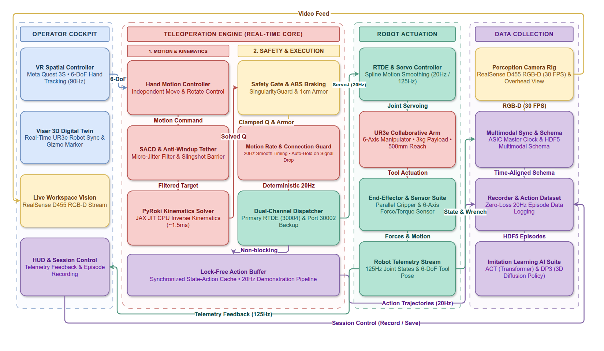
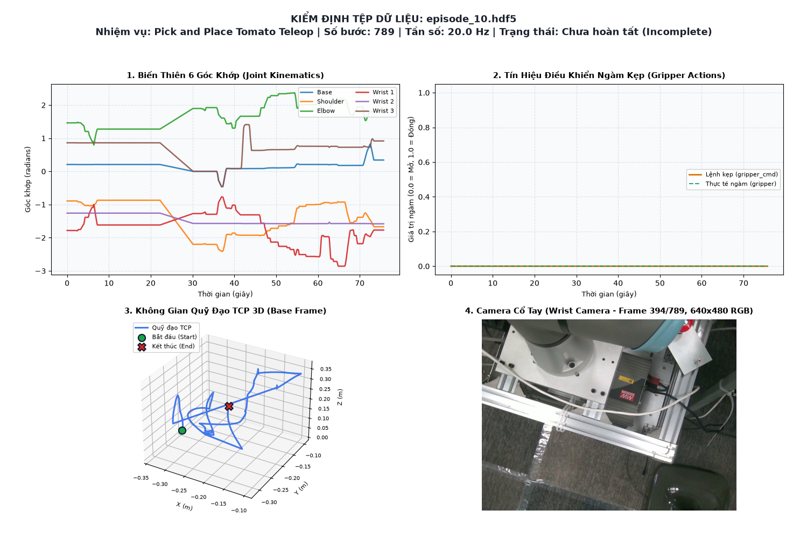

# UR3e Điều Khiển Teleoperation Thời Gian Thực qua Meta Quest 3S

Hệ thống điều khiển teleoperation thời gian thực và thu thập dữ liệu đa phương thức cho cánh tay robot Universal Robots UR3e qua kính Meta Quest 3S (WebXR) và trình duyệt Web (Viser 3D). Dự án tích hợp bộ giải động học nghịch (IK) siêu tốc thuần CPU dựa trên PyRoki/JAX (~1.0ms, không cần GPU) cùng module ghi luồng HDF5 chống tràn RAM tối ưu cho huấn luyện Robot AI (ACT, Diffusion Policy).

---

## 1. Tính Năng Nổi Bật

1. **Điều Khiển Teleoperation 20Hz & Cơ Chế Mặt Đồng Hồ (True Clock Navigation):**
   - **Vòng lặp RTDE 20Hz siêu nhạy:** Đồng bộ mục tiêu 6-DoF từ kính Meta Quest 3S hoặc chuột Viser 3D sang robot UR3e với độ trễ phản hồi $< 10$ms (`dt = 0.05`s, `lookahead_time = 0.11`s, `gain = 250`).
   - **Điều hướng Mặt Đồng Hồ cơ học (True Mechanical Clock):** Phải/Trái quay quanh trục Z đế ($q_0$) kèm tự bù ngàm kẹp; Tiến/Lùi vươn co bắp tay theo $\vec{u}_{reach} = [\cos(q_0), \sin(q_0), 0.0]$; Cao/Thấp theo phương Z thẳng đứng. Tổ hợp **Grip + Nút B** hiệu chuẩn tức thì hệ quy chiếu vuông góc bàn máy.
   - **Phân tách cử động độc lập:** Cò trỏ (Trigger) tịnh tiến thuần túy (khóa góc xoay); Cò giữa (Grip) xoay cổ tay bất biến tư thế (Horizon-Stabilized Triad: Lắc Z, Ngửa/Chúc Pitch, Vặn chìa khóa Roll). Bộ lọc vi rung sinh học (`rot_deadband = 0.026` rad $\approx 1.5^\circ$, `pos_deadband = 3`mm, `lat_deadband = 3.5`mm, `fwd_deadband = 1.5`mm).
   - **Khóa trục xoay thông minh (Soft Rotation Snapping):** Tỷ lệ xoay phụ $< 30\%$ (`snap_ratio = 0.30`) khóa cứng 1 trục; $30\% - 60\%$ (`smooth_high = 0.60`) chuyển tiếp mượt Hermite Smoothstep; $> 60\%$ xoay 3D tự do.
   - **Smart Clutching & Về Home 2 pha an toàn:** Tự động chốt mỏ neo tọa độ mới chống nhảy vọt (Zero Teleport). Quy hoạch về Home 2 pha 500Hz URScript qua Secondary Port 30002 bo cung bán kính `blend = 0.03`m (30mm), tự động kết nối lại RTDE mượt mà.

2. **Động Học Nghịch Siêu Tốc Thuần CPU (PyRoki + JAX/jaxls):**
   - **Giải bài toán IK ~1.0ms trên CPU:** Tối ưu hóa phi tuyến Levenberg-Marquardt bằng PyRoki, JAX JIT compile và `jaxls`, loại bỏ hoàn toàn nhu cầu trang bị GPU rời NVIDIA/CUDA.
   - **Hàm chi phí tối ưu toàn diện:** Bám vị trí `pos_weight = 60.0` (xoay thuần `120.0`), định hướng `ori_weight = 20.0` (xoay thuần `25.0`), rào chắn log barrier mềm (`barrier_weight = 20.0`, `violation_weight = 500.0`, đệm $0.03$ rad), chi phí neo dáng mồi `rest_cost = 0.005`, rào chắn mặt bàn (`weight = 1500.0`).
   - **Giới hạn khớp mở rộng & Auto-Snap:** Khớp khuỷu $[-0.08, +3.00]$ rad cho phép duỗi thẳng tay mượt mà; khớp nâng vai $[-2.65, +0.20]$ rad chống chúi cắm bàn; tự động thu hồi tọa độ Widget 3D về đầu tay máy thật (`fk_res`) và khôi phục hạt giống IK khi kẹt tracking quá 1.2s.

3. **Hệ Thống An Toàn Đa Lớp Thời Gian Thực 20Hz (Safety Gate & Phanh Mềm Chống Trip):**
   - **Rào chắn Descartes & Áo giáp tự va chạm 10mm:** Ràng buộc cao độ an toàn $Z \ge 0.020$m ($20$mm), góc vai $\le +0.20$ rad và áo giáp bảo vệ tự va chạm 10mm (hỗ trợ cờ `--disable-self-collision` để bypass khi cần).
   - **SingularityGuard 2 ngưỡng:** Ngưỡng nguy hiểm $\sigma_{danger} = 0.028$ chặn mục tiêu vi phạm và kích hoạt dừng an toàn; ngưỡng cảnh báo $\sigma_{warn} = 0.042$ kích hoạt vùng giảm chấn mềm liên tục (Continuous Soft Damping, gia tốc khớp $a \le 0.048$ rad/s²).
   - **Scaled Rate Limiter & Phanh mềm:** Tự động co giãn vận tốc 6 khớp ($\le 1.0$ rad/s) bảo toàn vector quỹ đạo trong không gian Descartes, triệt tiêu lệnh phanh gắt `servoStop()` chống Protective Stop cánh tay UR3e.
   - **Dây xích ảo chống văng (Anti-Windup Tether):** Giới hạn khoảng cách Descartes $D_{max} = 98$mm và leash xoay $0.45$ rad (tự siết về $0.15$ rad gần kỳ dị), triệt tiêu tích lũy trễ khi robot bị cản; tự phanh dừng an toàn nếu mất tín hiệu VR quá 1.0s.

4. **Thu Thập Dữ Liệu Robot AI & Bộ Công Cụ HDF5 Extraction Suite:**
   - **Ghi HDF5 Chunked Streaming + RingBuffer RAM:** Tối ưu hóa cho Robot Learning (ACT, Diffusion Policy, LeRobot), xả mẻ định kỳ chống tràn RAM (OOM) trong các phiên thu thập dài.
   - **Tùy biến luồng dữ liệu thời gian thực:** Bật/tắt linh hoạt 8 kênh dữ liệu trực tiếp trên Viser UI (Kinematics, Dynamics, Wrench, Payload, Safety Flags, Camera RGB/Depth).
   - **Đồng bộ VR & Tương tác 3D:** Ghi nhận đồng bộ tọa độ tay cầm VR, mục tiêu TCP, lệnh ngàm và tự động gắn cờ `PLACE_SUCCESS` khi gắp/thả vật thể ảo 3D thành công vào giỏ.
   - **Bộ công cụ xử lý tự động:** `core/visualize_data.py` (Sanity Check 2x2 GUI/PNG không cần màn hình) và `core/extract_hdf5.py` (tự động xuất video MP4 H.264, Depth PNG 16-bit, file CSV có header vật lý và tệp tóm tắt).

5. **Đồng Bộ Phần Cứng Cực Phân Giải & Luồng Stream Camera Đa Nguồn:**
   - **Đồng bộ Hardware Timestamp $< 1.5$ms:** Đọc trực tiếp hardware timestamp từ chip ASIC Intel RealSense, tự động tính Clock Offset đồng pha giữa luồng ảnh và RTDE robot (giảm jitter từ $\pm 35$ms xuống $< 1.5$ms).
   - **Kiến trúc CameraStreamPipeline 30 FPS:** Bộ đệm JPEG lưu trực tiếp trên RAM (Zero Disk I/O lag). Hỗ trợ linh hoạt: WebSocket RFC 6455 (`--cam-source ws`, trễ $< 3$ms), Ethernet ZeroMQ (`--cam-source eth`, socket `CONFLATE=1` triệt tiêu trễ mạng LAN), USB RealSense D435/D455 vật lý thật và Camera ảo 3D 640x480.

6. **Cockpit Tối Ưu, Giám Sát Hiệu Năng & Tự Động Hóa Vận Hành:**
   - **Tối ưu hóa phím tay cầm Meta Quest 3S:** Timer phân tách Short/Long Press (Nút B: Toggle Teleop / Go Home; Nút A: Record / Discard; Joystick: Click đóng mở ngàm, gạt ngang chỉnh độ mở mượt, gạt dọc chỉnh `Scale` $0.25\times - 3.0\times$, rung Haptic).
   - **Viser 3D UI tinh gọn:** Giao diện tiếng Anh 100%, bố cục lưới 2 cột khoa học, đồng bộ 2 chiều tức thì với tay cầm VR ($< 5$ms).
   - **Profiler & WebXR Watchdog:** Đo vi độ trễ 4 phân đoạn (IK $< 2.0$ms, Camera $< 1.0$ms, UI $< 5.0$ms, Loop $< 33.3$ms); tự dừng an toàn khi mất tracking $> 1.0$s; tự giải phóng Zombie Session qua `disposeSession()`.
   - **Tự động hóa hệ thống:** Tự phát hiện và kích hoạt Docker URSim; daemon `adb_watcher` tự động cấu hình port reverse (8443, 8444, 8080) sau 2s khi cắm cáp USB; chống timeout cổng Dashboard 29999 (bắt ngoại lệ timeout 2.0s, tự fallback sang RTDE 30004).

---

## 2. Kiến Trúc & Luồng Hoạt Động Của Hệ Thống


*Hình 1: Sơ đồ kiến trúc tổng thể giải pháp teleoperation robot UR3e qua kính Meta Quest WebXR và nền tảng thu thập dữ liệu AI đa phương thức.*

Toàn bộ hệ thống điều khiển teleoperation và thu thập dữ liệu vận hành theo chu kỳ đồng bộ 20Hz (chu kỳ 50ms), giao tiếp giữa người vận hành, máy chủ tính toán PyRoki CPU và bộ điều khiển Universal Robots UR3e qua các cổng mạng chuyên dụng: 29999 (Dashboard Server), 30002 (URScript Secondary Interface), 30003/30004 (RTDE ServoJ & Receive Interface), 8443 (HTTPS WebXR), 8444 (WSS Quest WebXR) và 8080 (Viser WebGL UI).

### 2.1. Phân Tầng Chức Năng Cốt Lõi

1. **OPERATOR COCKPIT (Trạm Điều Khiển Người Vận Hành):**
   - **VR Spatial Controller:** Tay cầm Meta Quest 3S định vị 6-DoF với tần số 90Hz qua giao thức WebXR, tích hợp cơ chế Dual-Clutch độc lập tịnh tiến và xoay cổ tay.
   - **Viser 3D Digital Twin:** Mô hình URDF 3D đồng bộ góc khớp thời gian thực qua WebGL kèm con trỏ Gizmo điều khiển trực quan.
   - **Live Workspace Vision:** Luồng ảnh RealSense D455 RGB-D và góc nhìn từ trên cao (Overhead) với độ trễ thấp Sub-50ms qua WebRTC.
   - **HUD & Session Control:** Bảng điều khiển giám sát viễn trắc (Tư thế Descartes, vận tốc, lực tiếp xúc) và phím bấm quản lý phiên ghi (Start, Save, Discard).

2. **TELEOPERATION ENGINE (Lõi Xử Lý Thời Gian Thực):**
   - **Phân luồng 1 - Motion & Kinematics:**
     - *Hand Motion Controller:* Phân tách độc lập 6-DoF tịnh tiến (ngón trỏ) và xoay cổ tay (nút hông), triệt tiêu rung giật chéo.
     - *SACD & Anti-Windup Tether:* Lọc vi rung (Deadband 3mm / 1.5°) và rào chắn neo chống văng Tether 98mm (`D_MAX_TETHER = 0.098`m, leash xoay $0.45$ rad) khi chạm vật cản.
     - *PyRoki Kinematics Solver:* Giải động học nghịch siêu tốc ~1.0ms bằng JAX JIT CPU thuần, tối ưu chuyển vị xoay và giữ tính liên tục của góc khớp.
   - **Phân luồng 2 - Safety & Execution:**
     - *Safety Gate & ABS Braking:* Giám sát SingularityGuard ($\sigma_{danger} = 0.028, \sigma_{warn} = 0.042$), giới hạn góc khớp và áo giáp bảo vệ mặt bàn 1cm, hãm phanh mềm ABS ($a \le 0.048$ rad/s²).
     - *Motion Rate & Connection Guard:* Vòng lặp định thời cứng 20Hz (50ms) bằng `perf_counter()`; tự động kích hoạt Fail-Safe khóa giữ vị trí an toàn khi mất sóng VR quá 1.0s.
     - *Dual-Channel Dispatcher:* Kênh chính UR RTDE (Port 30004) kèm kênh dự phòng Secondary Interface (Port 30002) chuyển mạch tự động dưới 1ms.
   - **Tầng đệm Lock-Free Action Buffer:** Bộ đệm đồng bộ phi khóa chuyển tiếp mượt mà chuỗi hành động 20Hz sang tầng dữ liệu mà không gây trễ chu kỳ điều khiển.

3. **ROBOT ACTUATION (Tầng Chấp Hành & Phần Cứng Robot):**
   - **RTDE & Servo Controller:** Tiếp nhận mục tiêu 20Hz, nội suy Spline và làm mượt chuyển động gia tốc bậc 3.
   - **UR3e Collaborative Arm:** Cánh tay robot 6 trục tải trọng 3kg, bán kính với 500mm, dẫn động servo trực tiếp chính xác cao.
   - **End-Effector & Sensor Suite:** Ngàm kẹp song song điều khiển hành trình/dòng kẹp, cảm biến lực/mô-men 6 trục (F/T Sensor) tại bích gắn tool.
   - **Robot Telemetry Stream:** Luồng viễn trắc 125Hz xuất ngược trạng thái góc khớp, vận tốc và tọa độ Descartes của đầu gắp.

4. **DATA COLLECTION (Tầng Thu Thập & Huấn Luyện AI):**
   - **Perception Camera Rig:** Camera RealSense D455 RGB-D 30 FPS và camera toàn cảnh cố định cân bằng trắng/độ phơi sáng.
   - **Multimodal Sync & Schema:** Đồng bộ thời gian qua chip ASIC phần cứng độ lệch $<1.5$ms, ánh xạ lược đồ HDF5 chuẩn hóa đa phương thức.
   - **Recorder & Action Dataset:** Ghi nhận chuỗi dữ liệu hành động 20Hz dạng luồng không suy hao và đánh tag phân đoạn tự động.
   - **Imitation Learning AI Suite:** Định dạng tương thích tức thì để huấn luyện các kiến trúc AI tiên tiến nhất (ACT Transformer, 3D Diffusion Policy DP3).

### 2.2. Quy Trình Vòng Lặp Điều Khiển Thời Gian Thực (Chu Kỳ 20Hz - 50ms)

Trong mỗi chu kỳ 50ms của `teleop_quest/main_quest.py`, hệ thống thực thi tuần tự 6 bước:

1. **Bước 1: Thu thập & Lọc tín hiệu điều khiển (`DeltaPoseSource` / `WidgetPoseSource`):**
   - Áp dụng cơ chế Mặt Đồng Hồ, bộ lọc Soft Rotation Snapping ($30\% - 60\%$) và vùng chết tĩnh (`POS_DEADBAND = 0.003`m, `ROT_DEADBAND = 0.026` rad).
   - Khống chế mục tiêu nằm trong hộp an toàn: $X, Y \in [-0.52, 0.52]$m, $Z \in [0.020, 0.60]$m, bán kính $R \in [0.10, 0.52]$m.

2. **Bước 2: Giải ngược động học siêu tốc trên CPU (`PyrokiIKSolver`):**
   - Giải bài toán bình phương tối thiểu phi tuyến trong ~1ms bằng PyRoki + `jaxls` trên CPU.
   - Áp dụng chi phí neo giữ `rest_cost` (weight 0.005) và `normalize_to_current` để bảo đảm tính liên tục của nghiệm góc khớp.

3. **Bước 3: Kiểm định an toàn & Điểm kỳ dị (`SafetyGate` & `SingularityGuard`):**
   - Đánh giá ma trận Jacobian của cấu hình mục tiêu. Kích hoạt Continuous Soft Damping nếu $\sigma_{min} < 0.042$ và chặn lệnh an toàn nếu $\sigma_{min} < 0.028$.
   - Kẹp vận tốc góc khớp tối đa qua Scaled Vector Rate Limiter ($\le 1.0$ rad/s).

4. **Bước 4: Thực thi lệnh thời gian thực (`ServoJExecutor`):**
   - Truyền gói 6 góc khớp mục tiêu $q_{target}$ qua RTDE bằng lệnh `servoJ(q, t=0.05, lookahead_time=0.11, gain=250)`.

5. **Bước 5: Ghi dữ liệu HDF5 & Mô phỏng gắp nhặt (`SelectableDataRecorder`):**
   - Mô phỏng tương tác vật lý hút/gắp vật thể cà chua 3D.
   - Nếu cờ ghi dữ liệu đang bật, nạp dữ liệu vào RingBuffer và xả xuống đĩa theo mẻ chunked HDF5 định kỳ.

6. **Bước 6: Thu nhận hình ảnh & Đồng bộ thời gian phần cứng (`CameraStreamPipeline`):**
   - Thu nhận frame ảnh đồng bộ thời gian từ RealSense hardware clock (độ trễ jitter $< 1.5$ms).
   - Nén MJPEG tích hợp lớp phủ OSD hiển thị trực tiếp lên WebXR Cockpit và Viser sidebar.


### 2.3. Cấu Trúc Thư Mục & Tổ Chức Mã Nguồn (Repository Layout)

```text
ur_ws/pyroki_ursim/
├── main.py                          # Điểm khởi chạy CLI thống nhất của hệ thống
├── activate_env.sh                  # Script kích hoạt môi trường Docker Offline / Alias nhanh
├── build_zip.sh                     # Script tự động đóng gói dự án thành ur3e_teleoperation.zip
├── Dockerfile                       # Image Docker Python 3.11-slim (CPU PyRoki, OpenCV, ZMQ, RTDE)
├── docker-compose.yml               # Cấu hình triển khai Zero-Setup với network_mode: host
├── .env.example                     # File mẫu biến môi trường cấu hình IP Robot và Camera
├── README.md                        # Tài liệu hướng dẫn sử dụng toàn diện
├── requirements.txt                 # Danh sách gói phụ thuộc Python (Top-level)
├── requirements.lock.txt            # Danh sách gói phụ thuộc khóa cứng (Pinned Docker)
├── reset_home.py                    # Script hỗ trợ khẩn cấp đưa robot về Home
├── assets/
│   ├── architecture.drawio          # Sơ đồ thiết kế kiến trúc toàn diện hệ thống
│   ├── ur3e_custom.urdf             # URDF UR3e có ngàm kẹp và camera offset
│   ├── obstacle_scene.yml           # Cấu hình ranh giới an toàn mặt bàn
│   ├── robot_camera_mount_1.stl     # Mô hình 3D ngàm gắn camera vào bích tool0
│   ├── d455.stl                     # Mô hình 3D camera Intel RealSense D455
│   ├── episode_0_visualization.png  # Ảnh tổng quan kiểm định dữ liệu đa phương thức (2x2 plots)
│   └── quest3_ctrl_*.glb            # Mô hình 3D tay cầm hiển thị phản hồi phím
├── config/
│   └── singularity.yaml             # Ngưỡng an toàn Jacobian singularity (sigma_min)
├── core/
│   ├── selectable_recorder.py       # Bộ ghi dữ liệu HDF5 dạng luồng phân mảnh
│   ├── extract_hdf5.py              # Công cụ giải nén HDF5 sang MP4, PNG 16-bit và CSV
│   ├── visualize_data.py            # Phân tích và trực quan hóa dữ liệu đa phương thức HDF5 (2x2 plots)
│   ├── pyroki_ursim_control.py      # Bộ điều khiển trung tâm (RTDE, PyRoki, URScript)
│   ├── verify_dataset.py            # Công cụ kiểm định chất lượng tệp HDF5
│   └── replay_episode.py            # Công cụ tái lập quỹ đạo thao tác
├── logs/
│   ├── ai_training_data/            # Tệp HDF5 lưu trữ các episode huấn luyện AI
│   ├── quest_runs/                  # Lưu vết dữ liệu teleoperation Meta Quest (.jsonl)
│   └── singularity_data/            # Dữ liệu ma trận suy biến Jacobian
├── safety/
│   ├── __init__.py                  # Khởi tạo package an toàn
│   └── singularity_guard/
│       ├── guard_core.py            # Giám sát điểm kỳ dị thời gian thực
│       ├── jacobian_metrics.py      # Tính toán giá trị suy biến nhỏ nhất sigma_min
│       └── calibration.py           # Hiệu chuẩn ngưỡng kỳ dị trong không gian làm việc
├── teleop/
│   ├── __init__.py                  # Khởi tạo package teleoperation
│   ├── pyroki_solver.py             # Bộ giải PyrokiIKSolver (JAX JIT CPU, ~1ms, rest_cost)
│   └── teleoperation.py             # TeleoperationController, ServoJExecutor, SafetyGate
├── teleop_quest/
│   ├── __init__.py                  # Khởi tạo package Quest teleop
│   ├── bootstrap.py                 # Điều phối khởi động (Docker URSim, ADB, SSL)
│   ├── camera_pipeline.py           # Quản lý luồng nền camera, preview OSD & streaming
│   ├── camera_driver.py             # Driver camera hợp nhất (USB, WebSocket RFC 6455 & ZeroMQ)
│   ├── camera_server_node.py        # Node phát stream video camera qua Ethernet ZeroMQ
│   ├── websocket_camera_server.py   # Node phát stream video camera qua mạng WebSocket (RFC 6455)
│   ├── synthetic_camera.py          # Render camera ảo cổ tay 640x480 (Eye-in-Hand)
│   ├── viser_ui.py                  # Giao diện Viser UI tinh gọn (Lưới 2 cột, 100% tiếng Anh)
│   ├── grasp_simulator.py           # Mô phỏng gắp/thả quả cà chua 3D vào giỏ
│   ├── quest_server.py              # Server HTTPS (8443) và WSS (8444)
│   ├── network_utils.py             # Dò tìm IP LAN và tự sinh chứng chỉ SSL
│   ├── pose_sources.py              # WidgetPoseSource đọc tọa độ chuột có lọc EMA
│   ├── delta_pose_source.py         # Cơ chế Mặt Đồng Hồ, Posture-Invariant Hand Frame & Deadzone
│   ├── timeout_watchdog.py          # Watchdog ngắt khẩn cấp khi mất tín hiệu
│   ├── home_planner.py              # Đưa robot về Home an toàn 2 pha (500Hz movej)
│   ├── profiler.py                  # Đo đạc vi độ trễ và xuất báo cáo hiệu năng mỗi 100 frames
│   ├── setup_quest_adb.sh           # Script chuyển tiếp cổng ADB sang localhost cho Quest
│   └── static/
│       ├── index.html               # Giao diện WebXR Cockpit trên kính Quest
│       ├── main.js                  # Xử lý gamepad WebXR, Toggle Gripper & phím VR
│       └── style.css                # Style hiển thị HUD hiện đại
└── tests/
    ├── test_system_profiler_and_watchdog.py # Kiểm thử Profiler, WebXR Watchdog & Dashboard Timeout
    ├── test_extract_hdf5.py         # Kiểm thử toàn diện công cụ giải nén HDF5
    ├── test_visualize_data.py       # Kiểm thử công cụ trực quan hóa đa phương thức HDF5
    ├── test_base_frame_rotation.py  # Kiểm thử xoay Base Frame và chiều xoay cơ học VR
    ├── test_vr_key_integration.py   # Kiểm thử phân tách phím vật lý VR A/X
    ├── test_vr_record_and_ui.py     # Kiểm thử Viser UI Checkbox và HDF5 streaming
    ├── test_realsense.py            # Kiểm thử SDK camera Intel RealSense
    ├── test_dual_camera.py          # Kiểm thử hệ thống camera đa phương thức (USB & Ethernet ZMQ)
    ├── test_websocket_camera.py     # Kiểm thử luồng camera qua mạng WebSocket (RFC 6455)
    ├── test_webxr_reconnect_and_occlusion.py # Kiểm thử khôi phục kết nối WebXR và góc khuất tay cầm
    ├── test_cockpit_joint_control.py# Kiểm thử điều khiển khớp 6-DoF trực tiếp trên Cockpit WebXR
    ├── test_collision_visualization.py # Kiểm thử hiển thị ranh giới va chạm 3D
    ├── test_joint_limits.py         # Kiểm thử giới hạn góc khớp và phanh mềm 20Hz
    ├── test_multi_layer_safety.py   # Kiểm thử hệ thống rào chắn an toàn đa lớp
    ├── test_simulated_pick_and_place.py # Kiểm thử chu trình gắp thả mô phỏng
    ├── test_singularity_guard.py    # Kiểm thử Jacobian singularity metric
    ├── test_camera.py               # Kiểm thử driver camera cơ sở
    └── test_viser_ui_layout.py      # Kiểm thử bố cục giao diện Viser UI
```

### 2.4. Bảng Thông Số Kỹ Thuật Điều Khiển Chính

| Thông số | Giá trị vận hành | Ý nghĩa kỹ thuật |
| :--- | :--- | :--- |
| **Tần số vòng lặp chính** | 20 Hz (`dt = 0.05`s) | Cân bằng tối ưu giữa chu kỳ RTDE servoJ và thời gian tính toán IK trên CPU. |
| **Tần số Camera Stream** | 20 FPS (WebXR) / 30 FPS (Camera) | Luồng nền độc lập, triệt tiêu hoàn toàn giật lag cho vòng lặp RTDE 20Hz. |
| **Thời gian giải PyRoki IK (CPU)** | `~1.0` ms | Giải trên CPU bằng JAX JIT sau warm-up, Levenberg-Marquardt qua `jaxls`. |
| **Trọng số bám mục tiêu IK (`pose_cost`)** | `pos = 60.0`, `ori = 20.0` | Bám chặt vị trí và hướng; khi xoay thuần tự động tăng lên `pos = 120.0`, `ori = 25.0`. |
| **Rào chắn giới hạn khớp IK (`limit_cost`)** | `barrier = 20.0`, `violation = 500.0` | Rào chắn log barrier mềm kẹp góc an toàn, vùng đệm kích hoạt `0.03` rad. |
| **Chi phí dáng mồi IK (`rest_cost`)** | `weight = 0.005` | Neo giữ nghiệm bám theo hạt giống `seed` của frame trước, đảm bảo tính liên tục (khi xoay thuần là `0.008`). |
| **Rào chắn mặt bàn & Tự va chạm** | `floor = 1200`, `table = 1500`, `coll = 40` | Ngăn ngừa va đập mặt bàn ($Z \ge 20$mm) và va chạm thân với biên áo giáp 10mm. |
| **ServoJ Lookahead Time** | `0.11` s | Cấu hình qua biến môi trường `SERVO_LOOKAHEAD` (mặc định 0.11s), nội suy dự đoán đa chu kỳ chuẩn UR. |
| **ServoJ Proportional Gain** | `250` | Cấu hình qua biến môi trường `SERVO_GAIN` (mặc định 250), độ cứng vị trí tối ưu giúp cánh tay lướt êm không giật. |
| **Vận tốc khớp tối đa (Rate Limiter)** | `1.0` rad/s ($\approx 57.3^\circ$/s) | Scaled Vector Limiter co giãn đồng bộ cả 6 khớp, bảo toàn 100% hướng vector Descartes. |
| **Bán kính làm việc tối đa ($R_{max}$)** | `0.52` m | Khống chế phạm vi vươn phù hợp tầm với 500mm của UR3e. |
| **Độ cao an toàn tối thiểu ($Z_{min}$)** | `0.020` m (20mm) | Chống cánh tay và ngàm kẹp va chạm mặt bàn ($Z \ge 20$mm). |
| **Ngưỡng Singularity Warning & Danger** | $\sigma_{warn} = 0.042$, $\sigma_{danger} = 0.028$ | Continuous Soft Damping ($a \le 0.048$ rad/s²) hãm mượt và chặn lệnh khi áp sát kỳ dị Jacobian. |
| **Dây xích ảo chống văng (Anti-Windup Tether)** | $D_{max} = 98$ mm, $\theta_{leash} = 0.45$ rad | Khống chế độ lệch Descartes và góc xoay mỏ neo, tự siết leash về $0.15$ rad khi gần điểm kỳ dị. |
| **Dung sai vị trí IK (`pos_err`)** | $< 0.018$ m (18mm) | Đảm bảo tỷ lệ hội tụ IK vùng biên vươn xa đạt $> 98\%$. |
| **Ngưỡng phát hiện vặn xoắn khớp** | `2.2` rad | Chặn các bước nhảy target đột ngột do đảo nhánh IK gần điểm kỳ dị. |
| **Giới hạn khớp khuỷu (`elbow_joint`)** | `[-0.08, +3.00]` rad ($[-4.6^\circ, +171.8^\circ]$) | Cho phép duỗi thẳng tay mượt mà, chống cùi chỏ tự gập sát đâm vào thân robot. |
| **Giới hạn khớp nâng vai (`shoulder_lift`)** | `[-2.65, +0.20]` rad ($[-151.8^\circ, +11.5^\circ]$) | Ngăn ngừa rủi ro đâm bắp tay xuống mặt bàn. |
| **Giới hạn các khớp còn lại (`pan`, `wrist_1..3`)** | `[-pi, +pi]` rad ($[-180^\circ, +180^\circ]$) | Nới lỏng toàn dải tự do, bảo vệ bằng mô hình Skin-tight Self Collision. |
| **Thuật toán quy hoạch Home** | URScript 2 pha `movej` | Chạy trực tiếp ở tần số 500Hz trên URControl qua cổng Secondary 30002 (`blend_radius = 0.03`m). |
| **Khôi phục Teleop sau khi về Home** | Tự động (Zero-Click) | Tự động kết nối lại RTDE và reset mỏ neo tay cầm VR ngay khi robot về đích. |
| **Vùng chết tĩnh tay cầm VR** | $3$ mm tịnh tiến, $1.5^\circ$ (`0.026` rad) xoay | Loại bỏ vi rung tay sinh học (`POS_DEADBAND = 0.003`m, `FWD = 0.0015`m, `LAT = 0.0035`m, `ROT = 0.026` rad). |
| **Tỷ lệ truyền chuyển động tay (`Scale`)** | `0.75` (Mặc định) | Điều chỉnh linh hoạt qua thanh trượt Viser UI hoặc Joystick Axes Y ($0.25\times - 3.0\times$). |
| **Độ lệch tay cầm tối đa (`max_delta_m`)** | `0.22` m | Khống chế bước dịch chuyển Descartes tối đa mỗi nhịp bóp cò. |
| **Ngưỡng thời gian Auto-Snap** | $1.2$ s | Tự động kéo tọa độ về đầu tay máy và reset seed khi bị kẹt tư thế. |
| **Khóa trục xoay cổ tay (Soft Snapping)** | $<30\%$ (cắt về 0), $30-60\%$ (Hermite Smoothstep) | Triệt tiêu góc xoay phụ khi gập/chúc cổ tay, $>60\%$ cho phép xoay 3D tự do đa hướng. |
| **Hiệu chuẩn hướng bàn máy** | Tổ hợp Grip + Nút B | Lấy góc yaw của kính (`head_quat`) làm hệ quy chiếu bàn máy cố định (`_desk_u_fwd`, `_desk_u_right`). |
| **Cơ chế kích hoạt ngàm kẹp** | Phím X (tay trái) / Joystick Click (Toggle) | Bấm 1 lần kẹp, bấm lần nữa nhả kèm rung Haptic (hỗ trợ cả R3/L3 và phím X). |
| **Cơ chế kích hoạt ghi dữ liệu** | Phím vật lý A (Toggle / Hold) | Nhấn nhả (< 2.0s) Bật/Tắt ghi dữ liệu; Nhấn giữ ($\ge 2.0$s) Hủy tập dữ liệu lỗi. |
| **Kiến trúc ghi dữ liệu HDF5** | Chunked HDF5 + RAM RingBuffer | Xả định kỳ xuống đĩa; triệt tiêu hoàn toàn rò rỉ bộ nhớ và lỗi OOM. |
| **Độ lệch thời gian phần cứng** | $< 1.5$ ms | RealSense ASIC chip hardware timestamp đồng pha với RTDE controller clock. |
| **Tốc độ trích xuất HDF5** | $> 500$ steps/s | Giải nén siêu tốc sang video MP4, ảnh PNG 16-bit và file CSV ngữ nghĩa. |
| **Tiến trình ADB Forwarding Watcher** | Chu kỳ quét 2.5 s | Tự động thiết lập đường hầm USB reverse cho WebXR khi cắm cáp. |

---

## 3. Cài Đặt Môi Trường & Hướng Dẫn Vận Hành

### 3.1. Kích Hoạt Nhanh Môi Trường (Khuyên Dùng - 100% Offline Qua Docker)
Người dùng trên máy tính mới **không cần cài đặt bất kỳ thư viện nào** (không cần pip, venv hay conda). Chỉ cần mở Terminal tại thư mục dự án và chạy:

```bash
source activate_env.sh
```
*(Nếu là lần đầu chạy trên máy mới, script sẽ tự động nạp file ảnh Docker Offline `teleop_quest_offline.tar` trong vài giây và thiết lập alias lệnh `python`. Bạn cũng có thể vào thẳng shell bên trong Docker bằng cách gõ `./activate_env.sh`).*

---

### 3.2. Cài Đặt Môi Trường Thủ Công (Dành Cho Nhà Phát Triển / Non-Docker)

#### Yêu Cầu Hệ Thống
- **Hệ điều hành:** Ubuntu 20.04 hoặc 22.04 LTS (x86_64).
- **Bộ vi xử lý:** CPU đa nhân (Intel Core i5/i7/i9 hoặc AMD Ryzen 5/7/9). Không yêu cầu card đồ họa rời NVIDIA hay GPU CUDA.
- **Bộ điều khiển Robot:** Trình giả lập Docker URSim hoặc Tủ điều khiển Robot UR3e thật (Cổng 29999, 30002, 30003/30004).

#### Bảng Thư Viện Python

| Thư viện | Phiên bản | Vai trò trong hệ thống |
| :--- | :--- | :--- |
| `jax[cpu]`, `jaxlie` | 0.4.20+, 1.0.0+ | Tính toán đại số Lie và biên dịch JIT siêu tốc trên CPU. |
| `jaxls` | git (brentyi/jaxls) | Bộ giải bình phương tối thiểu Levenberg-Marquardt cho bài toán IK. |
| `pyroki` | git (chungmin99/pyroki) | Thư viện động học và tối ưu hóa robot trên nền tảng JAX. |
| `yourdfpy` | 0.0.53+ | Phân tích cú pháp mô hình URDF robot (`assets/ur3e_custom.urdf`). |
| `robot_descriptions` | 1.10.0+ | Nạp mô tả động học robot tiêu chuẩn. |
| `torch` | 2.0.0+ (CPU) | Tính toán ma trận Jacobian và giá trị suy biến singular value. |
| `viser` | 0.2.0+ | Máy chủ WebGL 3D Visualization, Gizmo tương tác và giao diện Web UI. |
| `ur_rtde` | 1.5.0+ | Giao tiếp thời gian thực RTDE với bộ điều khiển Universal Robots. |
| `opencv-python-headless` | 4.8.0+ | Xử lý ảnh, truyền stream MJPEG, xuất video MP4 và xuất ảnh Depth 16-bit. |
| `pyrealsense2` | 2.54.0+ | SDK giao tiếp trực tiếp camera độ sâu Intel RealSense với hardware timestamp. |
| `transforms3d` | 0.4.1+ | Chuyển đổi giữa góc Euler, Quaternion và ma trận quay SE(3). |
| `trimesh` | 4.0.0+ | Phân tích lưới 3D robot, ngàm gắn camera và rào chắn vật cản. |
| `h5py` | 3.9.0+ | Ghi luồng HDF5 phân mảnh (Chunked) hiệu năng cao và trích xuất dữ liệu. |
| `pyyaml` | 6.0+ | Đọc cấu hình rào cản (`obstacle_scene.yml`) và ngưỡng kỳ dị (`singularity.yaml`). |
| `aiohttp` | 3.8.0+ | Máy chủ bất đồng bộ phục vụ WebXR HTTPS và WebSocket độ trễ thấp. |
| `cryptography` | 41.0+ | Tự động sinh chứng chỉ SSL/TLS cục bộ phục vụ kết nối HTTPS WebXR. |
| `numpy`, `scipy` | 1.24+, 1.11+ | Tính toán ma trận số học và bộ lọc tín hiệu làm mượt EMA. |
| `matplotlib` | 3.7.0+ | Trực quan hóa dữ liệu đa phương thức (đồ thị 2x2, quỹ đạo 3D trong `core/visualize_data.py`). |

#### Lệnh Cài Đặt Bằng Pip/Venv

```bash
# 1. Tạo và kích hoạt môi trường ảo Python 3.11
python3 -m venv .venv
source .venv/bin/activate

# 2. Cập nhật pip và cài đặt toàn bộ gói phụ thuộc
pip install --upgrade pip
pip install -r requirements.txt
```

---

### 3.3. Khởi Chạy Chương Trình (Gõ Lệnh `python` Y Hệt Máy Thật)
Sau khi kích hoạt môi trường ở Mục 3.1 hoặc 3.2, bạn có thể copy-paste trực tiếp toàn bộ các câu lệnh điều khiển bên dưới:

```bash
# 1. Chạy với URSim mô phỏng (Camera ảo 3D - Mặc định tự bật Docker):
python main.py --robot sim

# 2. Chạy với Robot UR3e thật (TỰ ĐỘNG DÒ TÌM IP QUA DHCP - Không cần nhập IP):
python main.py --auto

# Hoặc nếu đặt IP Tĩnh cố định:
python main.py --robot real --robot-ip 10.42.0.242

# 3. Chạy CẢ HAI: Robot UR3e thật + Camera Intel RealSense cắm cáp USB (Cấu hình chuẩn phòng Lab):
python main.py --robot real --robot-ip 10.42.0.242 --cam-source usb --camera realsense

# 4. Chạy CẢ HAI: Robot UR3e thật + Camera qua luồng mạng WebSocket (Khuyến nghị chuẩn mới):
python main.py --robot real --robot-ip 10.42.0.242 --cam-source ws --cam-url ws://127.0.0.1:8765
# (Trên máy phát chạy: python teleop_quest/websocket_camera_server.py --camera realsense --port 8765 --fps 30)

# 5. Chạy CẢ HAI: Robot UR3e thật + Camera qua cáp mạng Ethernet (ZeroMQ Zero-Lag):
python main.py --robot real --robot-ip 10.42.0.242 --cam-source eth --cam-url tcp://127.0.0.1:5555
# (Trên máy phát chạy: python teleop_quest/camera_server_node.py --camera realsense --port 5555 --fps 30)
```

> [!TIP]
> **Tùy chọn cấu hình cố định qua file `.env` (Zero-Config):**
> Thay vì phải nhập lại cờ `--robot-ip` hoặc `--cam-url` mỗi lần khởi chạy, bạn có thể sao chép và thiết lập sẵn file `.env`:
> ```bash
> cp .env.example .env
> ```
> Chỉnh sửa các giá trị theo thiết bị thực tế của phòng lab:
> ```bash
> ROBOT_IP=10.42.0.242           # Địa chỉ IP của Robot UR3e (hoặc 127.0.0.1 nếu chạy URSim)
> CAM_URL=tcp://10.42.0.100:5555  # URL nhận video camera qua mạng (ZeroMQ 5555 hoặc WS 8765)
> ROBOT_MODE=real                # Chế độ chạy: 'real' (Robot thật) hoặc 'sim' (URSim)
> CAM_SOURCE=eth                 # Phương thức camera: 'eth', 'ws' hoặc 'usb'
> ```
> *(Khi đã có file `.env`, bạn chỉ cần gõ ngắn gọn `python main.py`, hoặc khởi chạy ngầm toàn bộ dịch vụ qua Docker Compose bằng lệnh: `docker compose up -d` và dừng bằng: `docker compose down`).*

---

### 3.4. Mở Các Đường Dẫn Giao Diện (Localhost & VR)
Sau khi lệnh `python main.py ...` khởi động, toàn bộ dịch vụ mạng nội bộ sẽ lắng nghe trực tiếp trên máy của bạn:

1. **Trên Trình Duyệt Máy Tính:**
   - **Giao diện 3D Viser Dashboard:** [http://localhost:8080](http://localhost:8080) (Điều khiển 3D Gizmo bằng chuột, bật/tắt Teleop, ghi dữ liệu HDF5).
   - **Giao diện WebXR Cockpit:** [https://localhost:8443](https://localhost:8443)
   - **Giao diện URSim PolyScope (noVNC):** [http://localhost:6080](http://localhost:6080)

2. **Trên Kính Thực Tế Ảo Meta Quest (Meta Quest Browser):**
   - **Cách 1 - Cắm Cáp USB Type-C (Khuyến nghị - Tốc độ cao & Zero Lag):**
     - Cắm cáp USB nối kính Quest với máy tính.
     - Nếu Terminal xuất hiện dòng cảnh báo màu vàng:
       `[WARN] [QUEST USB] Phát hiện kính Quest nhưng CHƯA CẤP QUYỀN! Hãy đeo kính lên và bấm 'Allow USB Debugging'!`
       -> Đeo kính lên mắt, chọn **"Always allow from this computer"** rồi bấm **"Allow" (Cho phép)**.
     - Chờ dòng thông báo màu xanh lá hiện ra trên Terminal:
       `[OK] [QUEST USB] Đã kết nối cáp USB thành công! Mở trình duyệt trên Quest và vào ngay: https://localhost:8443`
     - Mở Meta Quest Browser trên kính và truy cập: **`https://localhost:8443`** *(vào được ngay lập tức)*.
   - **Cách 2 - Dùng Wi-Fi cùng mạng LAN với máy tính:**
     - Mở Meta Quest Browser trên kính và truy cập: **`https://<IP_LAN_in_trên_terminal>:8443`** (ví dụ: `https://192.168.1.15:8443`).

3. **Vượt Qua Cảnh Báo SSL Tự Ký Trên Trình Duyệt (Chỉ làm 1 lần đầu):**
   - WebXR yêu cầu bảo mật HTTPS. Vì chứng chỉ được hệ thống tự sinh nội bộ, trình duyệt sẽ hiện *"Your connection is not private"* (Kết nối không riêng tư).
   - Bạn chỉ cần bấm vào **Advanced (Nâng cao)** -> Chọn **Proceed to localhost (Tiếp tục truy cập)**.
   - Bấm nút **"Enter VR"** màu xanh để vào không gian điều khiển robot!

---

### 3.5. Điều Khiển Bằng Viser Web UI (Máy Tính)

Mở trình duyệt web trên máy tính và truy cập `http://localhost:8080`:

1. **Thư mục Teleoperation:**
   - **`Teleop` Checkbox:** Tích chọn để kích hoạt cánh tay robot bám theo mục tiêu (Status chuyển sang `Tracking`).
   - **`Gripper` Checkbox:** Tích chọn để đóng ngàm kẹp / hút vật thể (hoặc bỏ chọn để nhả vật thể).
   - *(Cả 2 checkbox trên được xếp gọn trên cùng 1 hàng ngang, mỗi ô chiếm 50% độ rộng).*
   - **`Scale` Slider:** Điều chỉnh độ nhạy chuyển động ($0.25\times - 3.0\times$) theo thời gian thực.
   - **`Go to Home` Button:** Kích hoạt quỹ đạo di chuyển 2 pha êm ái đưa robot về tư thế sẵn sàng an toàn.

2. **Thư mục Data Recorder Setup:**
   - **`Start Recording` Checkbox:** Bắt đầu phiên ghi HDF5 mới. Nhãn checkbox tự động đổi thành **`Recording (Ep X)`**. Bỏ tick để kết thúc phiên và lưu tệp xuống đĩa.
   - **`Discard` Checkbox:** Hủy bỏ phiên ghi hiện tại và xóa file HDF5 đang ghi dở (checkbox tự động nhả sau 200ms).
   - *(Cả 2 checkbox trên được xếp gọn trên cùng 1 hàng ngang, mỗi ô chiếm 50% độ rộng).*
   - **Lưới chọn luồng dữ liệu (2-Column Grid):**
     - Cột trái: `Kinematics`, `Wrench`, `Payload`, `RGB Camera`.
     - Cột phải: `Dynamics`, `Temperatures`, `Safety Flags`, `Depth Camera`.
     - Bỏ tick luồng nào sẽ tự động lược bỏ dataset tương ứng trong tệp HDF5.

3. **Thao tác Gizmo 3D:** Nhấp chuột và kéo các trục mũi tên hoặc vòng xoay của khối Target Widget 3D để điều khiển robot trực quan bằng chuột.

---

### 3.6. Hướng Dẫn Chi Tiết Điều Khiển Bằng Kính Meta Quest 3S (WebXR)

#### 3.6.1. Bảng Chức Năng Các Phím Trên Tay Cầm Meta Quest 3S (Tay Cầm Phải - Right Controller)

| Phím bấm | Thao tác / Thời gian | Chức năng chính | Phản hồi rung (Haptic) | Đồng bộ Viser UI | Mô tả chi tiết hành vi |
| :--- | :--- | :--- | :--- | :--- | :--- |
| **Cò Trỏ (Index Trigger)** | Bóp giữ ($> 0.25$) | **Dịch Chuyển Tịnh Tiến (Translation)** | Click nhẹ ($35\%$, $40$ms) khi bắt đầu bóp | Status: `Tracking` | Tịnh tiến theo cơ chế Mặt Đồng Hồ (khóa góc xoay). Nhả cò dừng robot ngay lập tức và reset mỏ neo tọa độ. |
| **Cò Giữa (Hand Grip)** | Bóp giữ ($> 0.25$) | **Xoay Góc Cổ Tay (Rotation)** | Click nhẹ ($35\%$, $40$ms) khi bắt đầu bóp | Status: `Tracking` | Xoay 3 trục độc lập cố định theo hệ tọa độ Gốc (Base Frame Left-Multiply): Pitch ngửa/cụp theo phương cánh tay hướng về thân Base, Roll xoay quanh cánh tay, Yaw xoay quanh Base Z. Nhả grip dừng robot ngay lập tức. |
| **Tổ Hợp Grip + Nút B** | **Bóp Grip & Nhấn B** | **Hiệu Chuẩn Bàn Máy (Calibrate Desk)** | Rung xác nhận ($80\%$, $150$ms) | Trục bàn máy cập nhật | Lấy góc yaw của kính (`head_quat`) làm hệ quy chiếu bàn máy cố định (`_desk_u_fwd`, `_desk_u_right`), triệt tiêu góc lệch khi đứng không vuông góc với bàn. |
| **Nút B** | **Nhấn nhả ($< 3.0$s)** | **Bật / Tắt Teleoperation (Toggle Teleop)** | Rung vừa ($70\%$, $150$ms) | Checkbox `Teleop` (Tick/Untick) | Chuyển đổi trạng thái điều khiển robot. Bật: `Tracking`; Tắt: Ngắt điều khiển tức thì (Safe Pause). |
| **Nút B** | **Nhấn giữ ($\ge 3.0$s)** | **Về Vị Trí An Toàn (Go Home)** | Rung mạnh ($100\%$, $300$ms) | Status: `Home`, Checkbox `Teleop` $\rightarrow$ Untick | Kích hoạt thuật toán quy hoạch quỹ đạo URScript 500Hz đưa robot về cấu hình khớp an toàn chuẩn. |
| **Nút A** | **Nhấn nhả ($< 2.0$s)** | **Bật / Tắt Ghi Dữ Liệu (Record AI)** | Bắt đầu: Rung ($90\%$, $200$ms)<br>Lưu: Rung ($50\%$, $100$ms) | Checkbox `Start Recording` (Tick/Untick)<br>Nhãn: `Recording (Ep X)` | Bấm lần 1: Bắt đầu episode mới. Bấm lần 2: Kết thúc và lưu tệp HDF5 hoàn chỉnh vào thư mục `logs/`. |
| **Nút A** | **Nhấn giữ ($\ge 2.0$s)** | **Hủy Tập Dữ Liệu (Discard Data)** | Rung cảnh báo ($70\%$, $300$ms) | Checkbox `Start Recording` $\rightarrow$ Untick<br>Status: `Discarded Episode` | Hủy bỏ phiên ghi hiện tại nếu thao tác lỗi/thất bại, xóa tệp HDF5 dở dang và giải phóng tài nguyên. |
| **Joystick Click (R3) / Nút X** | **Nhấn thẳng (Click) hoặc Nút X** | **Đóng / Mở Ngàm Kẹp (Toggle Gripper)** | Kẹp: Rung ($90\%$, $150$ms)<br>Nhả: Rung ($40\%$, $150$ms) | Checkbox `Gripper` (Tick/Untick) | Chuyển đổi trạng thái hút/kẹp hoặc nhả phôi của ngàm gắp điện / khí nén (hỗ trợ cả Click R3/L3 và phím X tay trái). |
| **Joystick Axes X** | **Gạt Trái / Phải** | **Chỉnh Độ Mở Ngàm Mượt Mà (Continuous Gripper)** | **Không rung** | Checkbox `Gripper` cập nhật khi vượt ngưỡng $50\%$ | Gạt Phải ($X > +0.35$): Khép dần ngàm gắp; Gạt Trái ($X < -0.35$): Mở dần ngàm gắp mượt mà. |
| **Joystick Axes Y** | **Gạt Lên / Xuống** | **Điều Chỉnh Độ Nhạy (Scale / Sensitivity)** | **Không rung** | Thanh trượt `Scale` Slider ($0.25\times - 3.00\times$) | Đẩy Lên ($Y < -0.35$): Tăng độ nhạy; Kéo Xuống ($Y > +0.35$): Giảm độ nhạy theo bước $0.05\times$. |
| **Nút Meta (Oculus)** | Nhấn giữ ($2.0$s) | **Căn Chuẩn Trục Nhìn (Recenter)** | Theo mặc định của kính | Không ảnh hưởng robot | Đồng bộ lại tâm không gian phòng thực tế ảo của kính Meta Quest. |

#### 3.6.2. Cơ Chế Mặt Đồng Hồ (True Mechanical Clock Navigation)
- **Tâm đồng hồ:** Trục quay khớp đế Base Z $(0, 0)$.
- **Kim đồng hồ:** Góc vật lý của khớp đế $q_0$.
- **Thao tác Sang Phải / Trái:** Quay kim đồng hồ (khớp đế $q_0$) quanh Base Z, tự động bù góc xoay trục Z ngàm kẹp để giữ ngàm luôn hướng thẳng vào bàn máy.
- **Thao tác Tiến / Lùi:** Duỗi dài hoặc thu ngắn kim đồng hồ theo đúng phương vươn cơ học $\vec{u}_{reach} = [\cos(q_0), \sin(q_0), 0.0]$, loại bỏ hiện tượng bị bẻ ngoặt khi kéo tay thẳng về sau.
- **Thao tác Cao / Thấp:** Nâng hạ độ cao Z thẳng đứng trên mặt bàn, luôn nằm trong khoảng an toàn $Z \in [0.020, 0.60]$m.

#### 3.6.3. Kỹ Thuật Ly Hợp Điều Khiển Tầm Xa (Smart Clutching)
Khi cần điều khiển robot di chuyển quãng đường dài vượt quá sải tay:
1. Bấm giữ Cò trỏ và đưa tay về phía trước đến hết tầm với thoải mái.
2. **Nhả Cò trỏ:** Robot dừng lại và giữ nguyên vị trí hiện tại.
3. Rút tay cầm về gần ngực hoặc vị trí thoải mái nhất.
4. **Bấm giữ lại Cò trỏ:** Hệ thống tự động neo mốc mới (Reset Anchor). Robot tiếp tục tiến tới mượt mà, hoàn toàn không bị nhảy vọt tọa độ (Zero Teleport).

#### 3.6.4. Kết Nối Kính Meta Quest Qua Cáp USB (Cơ Chế Auto-Heal ADB USB)
Để đạt độ trễ thấp nhất và triệt tiêu giật lag do sóng Wi-Fi:
1. Cắm cáp USB-C 3.0 giữa PC và kính Meta Quest.
2. Hệ thống chạy tiến trình ngầm **Auto-Heal ADB USB Daemon** liên tục mỗi 2.5 giây.
3. Nếu Terminal hiện cảnh báo màu vàng:
   ```text
   [WARN] [QUEST USB] Phát hiện kính Quest nhưng CHƯA CẤP QUYỀN! Hãy đeo kính lên và bấm 'Allow USB Debugging'!
   ```
   $\rightarrow$ Đeo kính lên mắt, tích chọn **"Always allow from this computer"** rồi bấm **"Allow" (Cho phép)**.
4. Chờ dòng thông báo màu xanh lá xuất hiện trên Terminal:
   ```text
   [OK] [QUEST USB] Đã kết nối cáp USB thành công! Mở trình duyệt trên Quest và vào ngay: https://localhost:8443
   ```
5. Mở trình duyệt Meta Quest Browser trên kính và truy cập:
   ```text
   https://localhost:8443
   ```
6. Bấm **Advanced** $\rightarrow$ **Proceed to localhost** $\rightarrow$ Bấm **Enter VR** để bắt đầu điều khiển.

*(Lưu ý: Kể cả khi người dùng bấm Allow muộn, hay đang chạy mà bị tuột dây USB cắm lại, hệ thống sẽ tự động khôi phục kết nối trong vòng 2 giây mà không cần khởi động lại chương trình!)*

---

### 3.7. Tự Động Đóng Gói Triển Khai (build_zip.sh)

Hệ thống tích hợp sẵn script tự động hóa [`build_zip.sh`](build_zip.sh) để đóng gói toàn bộ dự án thành file `ur3e_teleoperation.zip` gửi cho đối tác hoặc triển khai sang máy tính mới:
- **Tự động xuất Docker Image sẵn (`ur3e_teleoperation.tar`):** Đóng gói trọn gói Image Linux + Python 3.11 + PyRoki + Torch CPU để người nhận chạy 100% Offline mà không phải chờ tải mạng.
- **Bảo lưu file `.env` & dọn sạch rác:** Giữ lại cấu hình IP Robot (`ROBOT_IP`) và Camera (`CAM_URL`) hiện tại; tự động loại bỏ `.venv/`, `.git/`, `__pycache__/`, `*.log`.
- **Tự động làm sạch:** Xóa file zip cũ trước khi nén để tránh xung đột dung lượng.

**Lệnh thực thi:**
```bash
./build_zip.sh
```
*(Người nhận chỉ cần giải nén file zip và thực hiện 1 bước duy nhất tại [Mục 3.1](#31-kích-hoạt-môi-trường-sẵn-sàng-khuyến-nghị-dùng-docker-offline) để vận hành).*

---

## 4. Hướng Dẫn Triển Khai Trên Cánh Tay Robot UR3e Thực Tế

### 4.1. Kết Nối Phần Cứng & Cấu Hình Mạng LAN

Cắm cáp mạng Ethernet trực tiếp từ cổng mạng của máy tính PC (hoặc củ chuyển USB-to-Ethernet 3.0) vào cổng mạng trên tủ điều khiển UR Control Box.

#### Lựa chọn 1: Cấu hình tự động qua DHCP (Khuyên dùng)
1. Trên màn hình PolyScope Teach Pendant: Vào **Settings** $\rightarrow$ **System** $\rightarrow$ **Network**.
2. Chọn **DHCP** $\rightarrow$ Bấm **Apply**.
3. Chờ trạng thái chuyển sang màu xanh lá: **`Network is connected`**.
4. Ghi lại địa chỉ IP hiển thị (ví dụ: `10.42.0.242` hoặc `192.168.1.xxx`).
5. Trên máy tính điều khiển PC, kiểm tra kết nối:
   ```bash
   ping -c 3 <ROBOT_IP>
   nc -zv <ROBOT_IP> 29999 30002 30004
   ```

#### Lựa chọn 2: Cài đặt IP Tĩnh (`10.42.0.242`)
1. **Trên Teach Pendant:** Đặt IP `10.42.0.242`, Subnet `255.255.255.0`, Gateway `10.42.0.1`.
2. **Trên máy tính điều khiển (PC):** Đặt IP tĩnh `10.42.0.1/24` cho card mạng Ethernet qua lệnh `nmcli`:
   ```bash
   sudo nmcli con add type ethernet con-name "UR3e-LAN" ifname <TEN_CARD_MANG> ip4 10.42.0.1/24
   sudo nmcli con up "UR3e-LAN"
   ```

---

### 4.2. Quy Trình Chuẩn Hóa 10 Bước Trên Tay Dạy PolyScope

1. **Bước 1: Bật nguồn Control Box:** Bật công tắc cơ học trên mặt trước của tủ điều khiển UR.
2. **Bước 2: Thiết lập mạng LAN:** Xác nhận trong **Settings** $\rightarrow$ **System** $\rightarrow$ **Network** báo `Network is connected`.
3. **Bước 3: Kích hoạt Remote Control:** Vào **Settings** $\rightarrow$ **System** $\rightarrow$ **Remote Control** $\rightarrow$ Chọn **Enable**. Trên thanh tiêu đề header trên cùng, chuyển từ **Local** sang **Remote Control** (biểu tượng chuyển thành hình mạng máy tính).
4. **Bước 4: Khai báo TCP, Tải trọng (Payload) & Trọng tâm (CoG):**
   - Trong **Installation** $\rightarrow$ **General** $\rightarrow$ **TCP**: Khai báo offset (ví dụ: $Z = 0.135$m cho ngàm kẹp + mount camera).
   - Trong **Installation** $\rightarrow$ **General** $\rightarrow$ **Payload**: Khai báo khối lượng $\approx 1.1$ kg và CoG $Cx=0, Cy=0, Cz=0.045$m để chống lỗi dừng bảo vệ `Protective Stop: Position deviation`.
5. **Bước 5: Cấu hình mặt phẳng an toàn:** Trong **Installation** $\rightarrow$ **Safety** $\rightarrow$ **Planes**, thêm mặt phẳng hạn chế (*Restrict Plane*) cách mặt bàn vật lý $\ge 2$ cm.
6. **Bước 6: Tắt truyền thông Fieldbus:** Tắt Profinet và EtherNet/IP nếu không dùng PLC ngoại vi.
7. **Bước 7: Bật nguồn khớp & Nhả phanh:** Nhấn nút nguồn màu đỏ góc dưới bên trái màn hình, nhấn **ON**, sau đó nhấn **START / RELEASE BRAKES** đến khi trạng thái chuyển sang màu xanh lá (**RUNNING**).
8. **Bước 8: Đưa cánh tay về tư thế an toàn ban đầu (Ready Pose):** Đưa robot về góc khớp: Base $0^\circ$, Shoulder $-126^\circ$, Elbow $+109^\circ$, Wrist 1 $-90^\circ$, Wrist 2 $-90^\circ$, Wrist 3 $0^\circ$. Tránh tư thế duỗi thẳng cánh tay hoặc $q_5 = 0^\circ$ (kỳ dị cổ tay).
9. **Bước 9: Hạ thanh trượt tốc độ:** Kéo thanh trượt tốc độ (**Speed Slider**) xuống **10% – 20%** cho lần chạy thử nghiệm ban đầu.
10. **Bước 10: Giữ nút dừng khẩn cấp:** Người vận hành luôn cầm chắc Teach Pendant, ngón tay đặt sẵn trên nút Emergency Stop màu đỏ.

---

### 4.3. Hướng Dẫn Cấu Hình & Kiểm Tra Camera Vật Lý Độc Lập

Trước khi chạy teleoperation robot, hãy kiểm tra độc lập camera RealSense để đảm bảo luồng hình ảnh và hardware timestamp hoạt động chính xác:

```bash
# Kiểm tra nhận diện thiết bị USB
lsusb | grep -i intel
rs-enumerate-devices --short

# Chạy bài benchmark kiểm định RealSense tự động (đánh giá latency, FPS và timestamp)
python tests/test_realsense.py --gui

# Kiểm tra hệ thống camera đa phương thức (USB & Ethernet)
python tests/test_dual_camera.py

# Kiểm tra luồng WebSocket Camera (Client/Server)
python tests/test_websocket_camera.py
```

---

## 5. Quản Lý Dữ Liệu, Kiểm Định & Trích Xuất Dữ Liệu HDF5

### 5.1. Bảng Đặc Tả Cấu Trúc Dữ Liệu HDF5 Đa Phương Thức

Tập tin ghi hình (`logs/ai_training_data/episode_X.hdf5`) tuân theo định dạng chuẩn tương thích với ACT, Diffusion Policy và LeRobot:

| Đường dẫn Dataset | Kích thước (Shape) | Kiểu dữ liệu | Mô tả & Đơn vị vật lý |
| :--- | :--- | :---: | :--- |
| `action` | `[T, 7]` | `float32` | Góc khớp mục tiêu $[q_1..q_6]$ (rad) + lệnh kẹp $[0..1]$ |
| `actions/gripper_cmd` | `[T, 1]` | `float32` | Lệnh điều khiển ngàm kẹp chuẩn hóa $[0.0, 1.0]$ |
| `observations/qpos` | `[T, 6]` | `float32` | Góc khớp thực tế (rad): `[base, shoulder, elbow, wrist_1..3]` |
| `observations/qvel` | `[T, 6]` | `float32` | Vận tốc góc khớp thực tế (rad/s) |
| `observations/tcp_pose` | `[T, 6]` | `float32` | Tọa độ TCP thực tế: `[x, y, z]` (m) + `[rx, ry, rz]` (rotation vector rad) |
| `observations/tcp_speed` | `[T, 6]` | `float32` | Vận tốc TCP thực tế: `[vx, vy, vz]` (m/s) + `[wx, wy, wz]` (rad/s) |
| `observations/tcp_force` | `[T, 6]` | `float32` | Lực tiếp xúc đầu công cụ: `[fx, fy, fz]` (N) + `[tx, ty, tz]` (Nm) |
| `observations/ft_raw_wrench` | `[T, 6]` | `float32` | Lực/mô-men thô cảm biến F/T: `[fx, fy, fz]` (N) + `[tx, ty, tz]` (Nm) |
| `observations/vr_controller_pose` | `[T, 7]` | `float32` | Tọa độ tay cầm VR: `[x, y, z]` (m) + `[qx, qy, qz, qw]` (quaternion) |
| `observations/target_tcp_pose` | `[T, 6]` | `float32` | Tọa độ TCP mục tiêu phát lệnh: `[x, y, z, rx, ry, rz]` |
| `observations/gripper` | `[T, 1]` | `float32` | Trạng thái đóng/mở thực tế của ngàm kẹp $[0.0, 1.0]$ |
| `observations/currents` | `[T, 6]` | `float32` | Dòng điện động cơ 6 khớp (Amperes) |
| `observations/joint_voltages` | `[T, 6]` | `float32` | Điện áp động cơ 6 khớp (Volts) |
| `observations/temperatures` | `[T, 6]` | `float32` | Nhiệt độ động cơ 6 khớp ($^\circ$C) |
| `observations/payload` | `[T, 4]` | `float32` | Tải trọng công cụ: `[mass_kg, cog_x, cog_y, cog_z]` |
| `observations/tool_accelerometer` | `[T, 3]` | `float32` | Gia tốc kế đầu công cụ: `[ax, ay, az]` (m/s$^2$) |
| `observations/safety_flags` | `[T, 2]` | `int32` | Cờ trạng thái dừng khẩn cấp và dừng bảo vệ |
| `observations/timestamps_ms` | `[T]` | `int64` | Timestamp đồng hồ hệ thống (milliseconds) |
| `observations/timestamps_ns` | `[T]` | `int64` | Timestamp đồng bộ phần cứng camera RealSense (nanoseconds) |
| `observations/images/wrist_camera` | `[T, H, W, 3]` | `uint8` | Khung hình video màu RGB (định dạng RGB) |
| `observations/images/wrist_camera_depth` | `[T, H, W]` | `uint16` | Khung hình độ sâu Depth (khoảng cách vật lý tính bằng milimet) |

---

### 5.2. Công Cụ Trích Xuất Dữ Liệu Tự Động (`core/extract_hdf5.py`)

Tập lệnh giải nén tự động quét đệ quy toàn bộ cây dữ liệu HDF5 và xuất ra các tệp tin dễ đọc mà không can thiệp sửa đổi tệp HDF5 gốc:

#### Cú pháp dòng lệnh CLI:
```bash
# 1. Trích xuất mặc định (Tự tạo thư mục <tên_file>_extracted/ cùng cấp):
python core/extract_hdf5.py --file logs/ai_training_data/episode_0.hdf5

# 2. Chỉ định thư mục lưu kết quả tùy ý:
python core/extract_hdf5.py --file logs/ai_training_data/episode_0.hdf5 --output-dir /duong_dan/thu_muc_xuat

# 3. Ghi đè tốc độ khung hình (FPS) cho Video MP4:
python core/extract_hdf5.py --file logs/ai_training_data/episode_0.hdf5 --fps 30.0
```

#### Cấu trúc thư mục kết quả sinh ra:
```text
episode_0_extracted/
├── episode_metadata.json          # Toàn bộ thuộc tính phiên ghi (hz, duration, streams...)
├── summary.txt                    # Báo cáo thống kê tệp tin và dung lượng
├── wrist_camera.mp4               # Video MP4 đồng bộ tốc độ khung hình
├── wrist_camera_depth/            # Thư mục chứa chuỗi ảnh Depth PNG 16-bit
│   ├── depth_info.json            # Thống kê min/max/mean khoảng cách mm
│   ├── frame_00000.png            # Ảnh uint16 bảo toàn độ chính xác mm
│   └── ...
├── action.csv                     # Lệnh điều khiển góc khớp và ngàm kẹp
├── qpos.csv                       # 6 góc khớp thực tế có header ngữ nghĩa
├── qvel.csv                       # Vận tốc 6 góc khớp
├── tcp_pose.csv                   # Tọa độ Descartes TCP thực tế (m, rad)
├── vr_controller_pose.csv         # Tọa độ tay cầm VR (pos_x..z, quat_x..w)
├── target_tcp_pose.csv            # Tọa độ TCP mục tiêu ra lệnh
├── tcp_force.csv                  # Lực và mô-men tiếp xúc đầu công cụ
├── ft_raw_wrench.csv              # Dữ liệu đo thô từ cảm biến F/T
├── gripper.csv, gripper_cmd.csv   # Dữ liệu ngàm kẹp
├── currents.csv, joint_voltages.csv
├── temperatures.csv, payload.csv  # Trạng thái nhiệt độ và tải trọng
└── timestamps_ms.csv              # Dấu thời gian từng bước
```

---

### 5.3. Trực Quan Hóa & Kiểm Định Nhanh Đa Phương Thức (Data Visualization & Sanity Check)

Công cụ độc lập [`core/visualize_data.py`](core/visualize_data.py) hoạt động ở chế độ chỉ đọc (**Read-only**), giúp các kỹ sư AI nhanh chóng kiểm tra chất lượng dữ liệu (sanity check) trước khi nạp vào mạng nơ-ron học sâu (Deep Learning).



Bố cục tổng hợp 4 biểu đồ trực quan trên cùng một giao diện (Layout 2x2):
- **Top-Left (Kinematics):** Đồ thị 2D thể hiện sự biến thiên của 6 góc khớp (`qpos`).
- **Top-Right (Actions):** Đồ thị 2D thể hiện tín hiệu mở/đóng ngàm kẹp (`gripper_cmd` & phản hồi thực tế `gripper`).
- **Bottom-Left (Trajectory):** Đồ thị 3D không gian biểu diễn quỹ đạo di chuyển của đầu búp kẹp (`tcp_pose`), đánh dấu rõ điểm bắt đầu (Start) và điểm kết thúc (End).
- **Bottom-Right (Vision):** Khung hình ảnh màu RGB từ camera cổ tay (`wrist_camera`) tại thời điểm giữa phiên ghi.

#### Cú pháp dòng lệnh thực thi:
```bash
# 1. Hiển thị cửa sổ đồ thị 2x2 tương tác (đồng thời tự động xuất ảnh PNG cùng thư mục):
python core/visualize_data.py --file logs/ai_training_data/episode_0.hdf5

# 2. Chế độ Headless / Server (chỉ xuất và lưu file ảnh PNG tĩnh mà không mở cửa sổ GUI):
python core/visualize_data.py --file logs/ai_training_data/episode_0.hdf5 --no-gui

# 3. Chỉ định đường dẫn lưu ảnh PNG và chọn khung hình camera quan sát:
python core/visualize_data.py --file logs/ai_training_data/episode_0.hdf5 --save /duong_dan/anh_kiem_dinh.png --frame-idx 15
```

---

### 5.4. Kiểm Định & Tái Lập Quỹ Đạo (verify_dataset.py & replay_episode.py)

```bash
# 1. Kiểm định chất lượng tập dữ liệu (quét NaN, Inf, kiểm tra dt jitter, kích thước ảnh)
python core/verify_dataset.py

# 2. Tái hiện quỹ đạo Offline Dry-Run (Xem mô phỏng trên Viser, không gửi lệnh sang robot)
python core/replay_episode.py --file logs/ai_training_data/episode_0.hdf5

# 3. Tái hiện quỹ đạo Live Hardware Replay (Gửi lệnh thực thi trực tiếp trên URSim / Robot thật)
python core/replay_episode.py --file logs/ai_training_data/episode_0.hdf5 --execute --ip 10.42.0.242
```

---

### 5.5. Bộ Kiểm Thử Tự Động (pytest)

Chạy bộ kiểm thử để xác thực toàn diện các luồng teleoperation, trích xuất dữ liệu, trực quan hóa và giao diện UI:

```bash
# Chạy toàn bộ các bài kiểm thử tự động cốt lõi
pytest tests/test_extract_hdf5.py tests/test_visualize_data.py tests/test_vr_record_and_ui.py tests/test_vr_key_integration.py tests/test_base_frame_rotation.py -v
```
